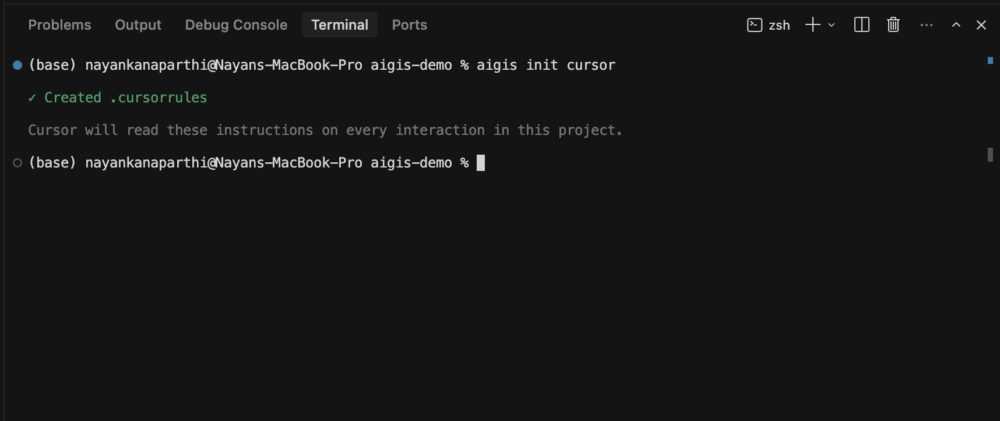
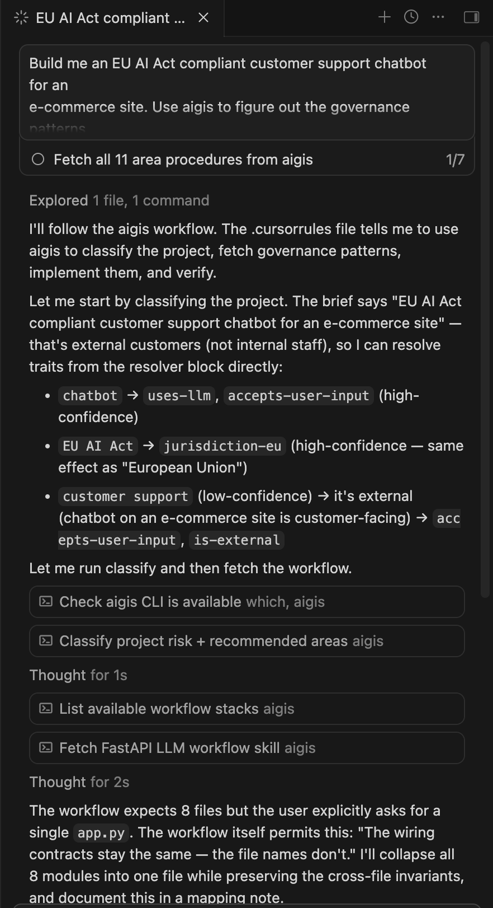
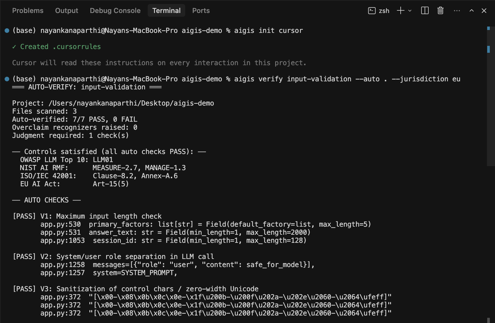

# Aigis

**AI governance that ships with your code.**

Aigis now understands how attackers attack AI systems and helps your agent build defenses against them.

Aigis sits between you and your coding agent (Claude Code, Codex, Cursor, GitHub Copilot or Windsurf) and gives the agent curated AI governance patterns mapped to NIST AI RMF, OWASP Top 10 for LLMs, ISO/IEC 42001, and the EU AI Act, with threat modeling from MITRE ATLAS.

You don't run Aigis. Your agent does. After one setup command, you describe what you're building and your agent picks the right governance patterns, implements them, and verifies the result, all in the same chat where you write code.

## What's new in v3.0

- **Two new areas for agentic systems.** `agent-permissions` covers agent identity, tool permissions and authority limits. `agent-tool-safety` covers tool invocation safety, validation of tool inputs and outputs, and scope drift.
- **`aigis classify` recommends both new areas when a system is agentic** (`is-agentic`). Builds, audits and reports for agentic projects include them too.
- **3.0 is additive: no command, flag or JSON key was removed or renamed.**
- Aigis now ships 21 governance areas and 17 verify checklists.
- **MITRE ATLAS mitigations cited** by `aigis classify`, `aigis verify --auto`, `aigis report` and `aigis build`, next to the existing OWASP, NIST and ISO citations.
- **`aigis threats`** builds a threat model from your traits: attacker techniques for your entry points, the mitigations MITRE links to each, the Aigis areas that help implement each one (in part), and the gaps.
- **`aigis template threat-model`**, a fill-in threat model worksheet.
- **Your agent is instructed to threat-model on its own.** The core skill that `aigis init` writes tells the agent when to run `aigis threats` without being asked, and `aigis audit --scan` has a new threat model phase.
- **Pinned ATLAS v2026.10 data, offline.** The catalog ships inside the package. No network calls.

### Results

Tested with a real coding agent building agent features from plain requests, with no Aigis, with Aigis 2.1.1 and with Aigis 3.0 (6 runs each), all graded in one blind pass:

| | No Aigis | Aigis 2.1.1 | Aigis 3.0 |
|---|---|---|---|
| Agent-safety defenses present in the code | 43% | 75% | **90%** |
| Agent ran a threat model on its own | n/a | 0 of 6 | **6 of 6** |
| Agent told the user about uncovered gaps | n/a | 1 of 6 | **6 of 6** |

Every MITRE ATLAS reference Aigis prints matched MITRE's own data (9,604 checked). Small sample; method, limits and a correction to the first published numbers in [`BENCHMARKS.md`](BENCHMARKS.md).

## Install

```bash
pip install aigis-cli
# or
npm install -g @aigis-ai/cli

cd your-project
aigis init cursor      # or: claude-code, codex, copilot, windsurf
```

That's it. `aigis init` writes a single rules file (`.cursorrules` for Cursor, `.github/copilot-instructions.md` for Copilot, etc.) that teaches your agent the Aigis workflow. Your agent reads it on every interaction in this project.



## Quick start

Open the project in your IDE. In the agent chat, just describe what you're building:

> *Build me an EU AI Act compliant customer support chatbot for an e-commerce site. Use aigis to figure out the governance patterns and apply them.*

Building an agent that can take actions, like sending email or querying a database? Ask for the feature in plain words. Your agent is instructed to run `aigis threats` on its own, fetch the defenses that apply, and tell you about any gaps.

Your agent will read `.cursorrules`, classify the description against the resolver, fetch the relevant procedures, and implement them, invoking `aigis` itself as it works:



When the agent is done, you can verify deterministically:

```bash
aigis verify input-validation --auto . --jurisdiction eu
```



The whole loop, describe, implement, verify, happens without leaving the IDE. You stay in the chat; the agent uses the CLI.

## What `aigis init` actually did

When you ran `aigis init cursor`, three things landed in your repo:

1. **`.cursorrules`** — the Aigis "core skill" your agent loads on every interaction. It documents the workflow (`classify → build → implement → verify → report`) and embeds a 39-phrase resolver block (high-confidence and low-confidence triggers) the agent uses to pick traits from your description.
2. **A checksum** at the top of the resolver block. When Aigis updates, `aigis init <ide> --refresh` replaces only the Aigis section and keeps the rest of the file; mismatched checksums error out so you can see what changed.
3. **No hidden services. No telemetry. No background processes.** Just a markdown file your agent reads.

Optional add-ons at init time:

```bash
aigis init cursor --ci github    # drops .github/workflows/aigis.yml
aigis init cursor --hook         # installs .git/hooks/pre-commit
```

Both surfaces read a single `.aigisrc.json` config:

```json
{ "areas": ["pii-handling", "audit-logging"], "jurisdiction": "eu" }
```

The CI workflow runs `aigis verify` on every PR; the pre-commit hook runs it before each commit. Configure once, both run.

## Threat modeling with MITRE ATLAS

OWASP says what can go wrong. MITRE ATLAS says how an attacker does it. NIST AI RMF says how you govern it.

```bash
aigis threats --traits uses-llm,uses-rag,is-agentic
aigis threats "<description>"
```

`--traits` is the reliable path. The description path only finds traits the resolver recognizes.

What you get: the techniques for your entry points, Realized first (seen in real attacks); the mitigations MITRE links to each technique; the Aigis areas that help implement each mitigation (in part); and the gaps, mitigations with no mapped Aigis area. `--redteam` adds test stubs, `--json` is for scripts.

When: designing an AI feature; adding a capability (tools, write access, memory, a new data source); before launch; after an incident. Your agent is instructed to do this at those moments without being asked, and you can run it yourself at any time.

What ships: a pinned subset of ATLAS v2026.10 (16 tactics, 221 techniques, 44 mitigations, counts from 77 case studies). No network calls. Aigis areas currently map to 21 of the 44 mitigations.

The mapping from areas to mitigations is ours. The links from mitigations to techniques are MITRE's. The entry points come from a reviewed map of 9 traits to 29 techniques.

Limits: MITRE ATLAS is a threat catalog, not a standard. Nobody is "ATLAS compliant". It does not score risk, and it does not cover bias or fairness. A cited mitigation means the area helps implement it (in part). The technique list is a starting point based on your traits, not proof of coverage.

## What's new in v2.1

- **EU AI Act mapping** — Articles 9, 10, 12, 13, 14, 15, 50, 72, 73 mapped to runnable governance patterns, plus an Annex IV technical documentation template
- **`--jurisdiction` flag** (`eu`, `us-regulated`) — gates content by where you ship. EU AI Act citations only surface when you're shipping to EU users
- **`aigis report`** — generates audit-ready compliance documentation with cross-framework citations (NIST + OWASP + ISO + EU AI Act) and file:line evidence per check
- **Activation surfaces** — `aigis init --ci github` drops a GitHub Action; `aigis init --hook` installs a pre-commit hook
- **`--tight` flag** (experimental) — minimal briefs for users who want less context. Requires ≥2 trait matches per area instead of ≥1
- **Resolver expansion** — 27 new triggers covering modern AI project types (internal coding assistants, agentic code review, document Q&A, image generation, enterprise search) and EU Annex III high-risk categories (biometric ID, credit scoring, hiring, law enforcement)

## The principle behind Aigis

Governance isn't a content problem. It's an interface problem.

NIST AI RMF, OWASP Top 10 for LLMs, ISO/IEC 42001, and the EU AI Act are all rigorous, all published, and all sit in documents that engineering teams never read. Aigis treats governance as an **agent-computer interface** problem: how the right content reaches an LM agent at the right time, in the right shape.

- Context layered for on-demand loading (core skill always loaded; per-area procedures fetched when needed)
- Deterministic rules where accuracy isn't negotiable (resolver triggers, brief generation, verify regexes)
- Flexible reasoning where real projects don't fit rigid templates (the brief tells the agent to skip areas that don't apply, with a written reason)

Inspired by [SWE-agent's work on agent-computer interfaces](https://arxiv.org/abs/2405.15793), the idea that *how* information reaches an LM agent matters as much as *what* reaches it.

## Manual CLI reference (for CI, scripting, audit prep, power users)

The CLI exists in case you want to drive Aigis directly, for CI workflows, audit prep, debugging, or one-off invocations.

```bash
# Classification + brief
aigis classify "<description>"               # detect traits + recommended areas
aigis build "<description>"                  # the consolidated brief (the main command)
aigis build "..." --jurisdiction eu          # surface EU AI Act content for EU-bound systems
aigis build "..." --tight                    # minimal brief: ≥2 trait matches required (experimental)
aigis build "..." --list                     # area names + traits, no procedure content
aigis build "..." --compact                  # pointer-only brief

# Per-area work
aigis get <area>                             # fetch a single governance procedure
aigis infra <area>                           # fetch infrastructure pattern (rate-limiting, secrets, logging)
aigis workflow <type>                        # fetch workflow template

# Verify + audit
aigis verify <area> --auto .                 # deterministic check on your implementation
aigis verify <area> --auto . --jurisdiction eu   # surfaces EU AI Act citations in output
aigis report --from-classify "<desc>" --jurisdiction eu --output audit.md
                                             # audit-ready compliance documentation
aigis audit --scan                           # discovery prompt for auditing existing code
aigis audit --traits <list>                  # scoped audit with deterministic denominator

# Threat modeling (MITRE ATLAS)
aigis threats --traits <list>                # techniques, MITRE mitigations, Aigis areas, gaps
aigis threats "<description>" --redteam      # same from a description, plus red-team test stubs
aigis template threat-model                  # threat model worksheet

# Misc
aigis search --list                          # list all available areas
aigis traits                                 # list classification traits
aigis template <id>                          # compliance documentation template
```

Run `aigis --help` for full options.

## Honest about what this isn't

- **Not a certification.** EU AI Act conformity assessment requires a notified body. `aigis report` is preparation material; it does not certify.
- **Not a security audit.** `aigis verify` is heuristic regex over your source. It catches common misimplementations; it doesn't replace SAST, code review, or penetration testing.
- **Doesn't run your code or call your APIs.** The agent does the work. Aigis provides the brief, the verifier, and the audit doc.
- **Local. No cloud. No telemetry.** Aigis ships nothing back to a server. Your descriptions, your code, and your verify results stay on your machine.
- **Not a penetration test.** `aigis threats` lists known techniques for your traits. It does not attack or test your system.

## Benchmark results

### v3.0

See [Results](#results) above. Full method, per-defense tables and limits: [`BENCHMARKS.md`](BENCHMARKS.md).

### v2.0

v2.0 was benchmarked at every iteration. Final numbers, against the same 10 descriptions:

- Baseline (Aigis v1.0.3): P=0.737, R=0.905, F1=0.790
- v2.0 (`aigis build`): P=0.847, R=0.851, F1=0.837

F1 beats baseline by +0.047. v2.1 ships `--tight` as a flag-gated experiment; promotion to default is pending a confirmation benchmark. Methodology, per-run tables, and the v2.1 manual end-to-end test live in the [`benchmarks/`](https://github.com/NayanKanaparthi/aigis) directory.

## Supported agents

- Claude Code
- Codex: `aigis init codex` writes `AGENTS.md`, which Codex reads, and keeps any content you already have there
- Cursor
- GitHub Copilot
- Windsurf

Each maps to a different rules file location. `aigis init <ide>` handles the difference; `--refresh` updates safely.

## Contributing

Aigis is built around a curated trigger map for classification. Trigger contributions are welcome, with a one-sentence use-case justification per the template in `.github/PULL_REQUEST_TEMPLATE/trigger_mapping.md`.

See `CONTRIBUTING.md` for the full contributor workflow, including how to add new governance areas, workflows, infrastructure patterns, or EU AI Act article mappings.

## License

Aigis is MIT licensed. The package also includes a copy of MITRE ATLAS data (`content/index/atlas.json`). That data belongs to MITRE and is shared under its own open license, which allows reuse as long as MITRE's notice and license text travel with it. Both are in `content/index/atlas-NOTICE.md` (Apache-2.0).
